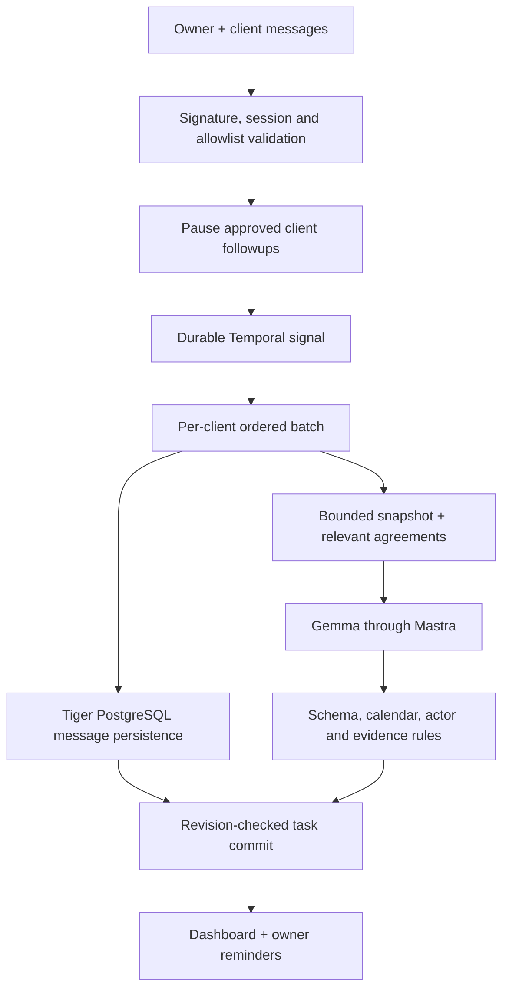

# Architecture and context policy

[High-level architecture diagram and component guide](docs/SYSTEM-OVERVIEW.md) · [PNG](docs/followthrough-architecture.png) · [SVG](docs/followthrough-architecture.svg)

## Durable intake, direct inference

The incoming message objects flow directly to inference; the hot path never writes those objects to Tiger PostgreSQL merely to read them back for the prompt. A workspace snapshot still supplies existing tasks and previous context. New messages are labeled owner/client data, never elevated to system instructions.

Pausing outbound approvals is a synchronous database barrier. This is deliberate: a delayed model must not leave an outdated follow-up eligible to send. Temporal acknowledges events durably before webhook success; Tiger PostgreSQL persists the batch alongside generation. Local development substitutes file persistence and an explicitly limited scheduler.

## Context and inference budget

- Batch after five idle seconds, at most fifteen seconds; eight messages per analysis chunk.
- At most twenty active tasks and 24,000 message characters before provider-specific fitting.
- New message IDs identify the fresh portion; message text appears only once.
- Provider message and task IDs are replaced with short request-local aliases for inference and restored before evidence validation. Pending review requests supply continuity but are never treated as existing tasks.
- Existing task evidence and recent turns supply continuity; Tiger returns at most four older agreement references, filtered by client and checked against Tiger PostgreSQL.
- Local Ollama defaults to a 4,096-token context setting. Input fitting uses a conservative character estimate with reserved output space. This is an estimate, not a tokenizer guarantee; token accounting is recorded when supplied.
- Remove old context before shortening new text. Dropping active tasks or shortening new messages forces review instead of automatic commitment.
- Structured JSON schema, low temperature, bounded output and one repair attempt. Local reasoning is disabled where the model supports `reasoning_effort=none`.
- Resolve common weekday/today/tomorrow dates using the source message's local calendar. Ambiguous “next Friday” requires review. Correct obvious owner/client request responsibility with deterministic rules.
- Conversational owner acceptance creates an open task automatically, citing the request and acceptance. Questions proposing a new deadline remain under review until agreement. Repeated analysis replaces matching pending review cards; an accepted task removes its superseded requests. Validation failures receive one model repair attempt, including evidence and task-reference errors.
- Relative-date deadlines preserve explicit AM/PM clock times in the configured timezone. An ordinal date before a reason clause takes precedence over unrelated dates mentioned in that reason.
- One model generation at a time per process. Per-client workflows serialize task changes. The server-level queue is not a distributed rate limiter.
- Local mode never calls OpenRouter. Hosted fallback only accepts configured free Gemma IDs. Daily quota accounting and an automatic quota-resume mechanism are still outstanding; failures retain unanalyzed messages for retry.

## Safe actions

AI can propose a task or editable reply. It cannot invoke sending. Every outgoing message has an owner-approved recipient/text/time and an outbox record. Scheduled sends require unchanged task revision and conversation sequence. New activity, cancellation, uncertainty or excessive delay prevents automatic sending. Network ambiguity is not automatically retried.

The current reconciliation matches an outgoing echo to an uncertain outbox entry only by client, text and a small time window. It is a pilot heuristic, not an exactly-once guarantee. Full provider-history reconciliation remains required before wider use.

## Recovery and deployment boundaries

Tiger PostgreSQL's optimistic workspace revision protects concurrent API/worker updates. The pilot uses a JSONB workspace row capped at 12 MB, updated with compare-and-swap on a separate revision column. Larger usage needs normalized entity tables and archival. The same Tiger database holds the authoritative workspace and a rebuildable embedding/search index in separate tables.

Temporal activities may retry a failed composite batch, including inference if the prior result was not committed. Independent inference-result checkpoints are a future optimization; do not claim they exist. File mode recovers unanalyzed messages after restart but does not provide distributed durability.

Production configuration requires Tiger PostgreSQL, Temporal and individual account login. QR connector and Temporal development server remain private. No account numbers or provider keys are committed. Real integration and hosted tests await deployment configuration.

## Account isolation (15 October 2026)

Authenticated opaque sessions resolve an account ID on the server. An AsyncLocalStorage workspace context is required by state and retrieval operations; missing context fails closed. Each account has a separate state row/file. Retrieval uses a composite `(workspace_id,id)` key and workspace filters in both keyword/vector branches and the final join, including when message or client IDs collide across accounts.

Each registered user has WAHA session `ft-<account UUID>`. Signed webhooks map the session to an account before phone/allowlist verification. The shared connector key is server-only. Pairing controllers are keyed by account session. `conversationWorkflowV2`, `sendWorkflowV2`, and `reminderWorkflowV2` carry the tenant in their arguments, use namespaced workflow IDs and run on `followthrough-v2`. Activity wrappers restore the workspace context before calling service functions. Legacy singleton history is preserved on the old queue and never assigned to a new registrant.

Passwords use asynchronous salted scrypt and timing-safe comparison. Login limits and revocable hashed sessions persist in Tiger or the single-process local auth file. Cookie sessions have seven-day absolute and 24-hour idle expiry, with CSRF header/origin checks on mutations. Production cookies require HTTPS. Changing the saved owner number requires disconnecting the current WhatsApp session first. Removed client numbers retain history but cannot receive new ingestion or sends.

## Telegram channel (15 October 2026)

An embedded GramJS MTProto adapter maintains one personal Telegram connection per authenticated account. QR login is initiated only by the owner; optional two-step verification is consumed in memory. The linked account's phone must match its saved Telegram owner number. StringSession secrets are AES-256-GCM encrypted in a separate private repository with workspace-bound authenticated data; they never enter model context or dashboard state.

Clients/conversations carry a provider and authoritative provider peer ID. Legacy clients default to WhatsApp. Telegram private-user updates normalize to the existing message contract with IDs namespaced by workspace, peer and provider message ID. The same Temporal conversation workflow, source-evidence checks, Gemma extraction, task calendar, approvals and outbox serve both channels. Task provenance comes from the stored conversation, never a model-selected channel. Sending dispatches by the stored client channel. Cross-platform contacts are not automatically merged.

Telegram starts/restores inside the API, uses the embedded activity worker for sends, and rejects standalone-worker send attempts to prevent duplicate session ownership. Startup primes private-chat entity caches and performs bounded newer-message recovery for existing allowed chats. Cold historical import, multi-instance session leases, unrestricted offline backfill and media/edit/delete processing are not implemented. Browser workers do not provide provider access. No new Redis or additional Telegram server is introduced.
