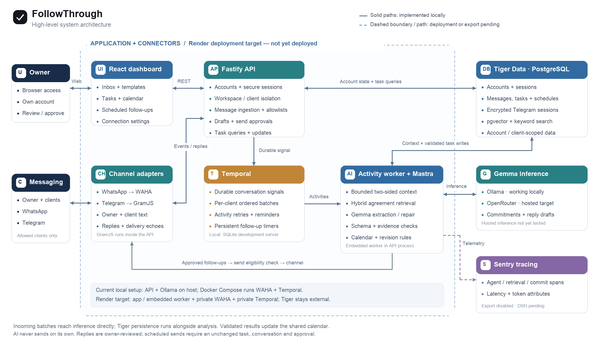

# FollowThrough system overview

[Editable SVG](followthrough-architecture.svg)

## What each component contributes

| Component | Its job in FollowThrough |
|---|---|
| React | The owner's inbox, task calendar, templates, scheduled follow-ups, client management and connection setup. |
| Fastify + TypeScript | Authenticates account sessions, isolates workspaces, validates incoming events and serves the dashboard API. It handles owner-approved send requests and protects account credentials. |
| WAHA | A server adapter for the owner's QR-linked WhatsApp account. Supplies message events and sends approved replies. |
| GramJS | The embedded personal Telegram adapter. QR login creates an encrypted account-specific session; private allowed conversations join the shared inbox. |
| Temporal | Records incoming signals durably, serializes per-client batches, retries failed analysis activities, and maintains reminder/follow-up timers across worker restarts. Its local SQLite development server has its own history disk. |
| Mastra | Runs the actual Gemma agent calls for extraction, repair and editable drafts. Today bounded context/retrieval, validation and task commits are application code around those calls, not Mastra memory/tools or a Mastra workflow. |
| Gemma | Interprets both speakers: request versus commitment, who owes what, agreed dates, changes and completion. It produces proposed structured changes or editable text. It has no send authority. |
| Ollama / OpenRouter | Alternative inference routes for Gemma. Ollama is the working local endpoint; OpenRouter is the selected hosted route and still needs an authenticated end-to-end test. |
| Tiger Data | PostgreSQL is the authoritative store for account state, messages, tasks, approvals and encrypted Telegram sessions. pgvector plus full-text search retrieves relevant prior agreements with account/client isolation. |
| Sentry | Instrumentation measures model calls, retrieval, task commits and dispatch. Export remains disabled until a DSN is configured; connected trace evidence is still pending. |
| Render | Target hosting for the dashboard/API/embedded worker and private WAHA/Temporal services. The blueprint exists; the hosted deployment has not been verified. |
| Docker Compose | Starts the local WAHA and Temporal services. In the current local setup, the API and Ollama run on the host. |

## How an incoming message becomes a task

1. WAHA or GramJS receives an owner/client message. The API checks session identity and whether the conversation is allowed.
2. New conversation activity pauses approved follow-ups before AI analysis, so an old approval cannot send against a changed conversation.
3. A durable Temporal signal queues an ordered batch for that client. The activity worker receives the message objects directly.
4. Current tasks, bounded recent messages and relevant Tiger search results supply context. Message persistence runs alongside analysis; the batch is not written and reread merely to create the prompt.
5. Mastra calls Gemma. Application code checks schema, evidence, calendar/timezone, actor responsibility and task revisions. Clear commitments become tasks; uncertain changes become review requests.
6. Validated state is saved in Tiger. The dashboard refreshes to show tasks, calendar dates, reviews and reminders.

## Outgoing messages

An immediate reply uses the owner's reviewed text and selected conversation. A scheduled follow-up also requires an exact approved time, unchanged task revision and unchanged conversation sequence. Temporal supplies the timer; deterministic application checks decide whether sending is still permitted. New activity pauses the follow-up. Unknown provider delivery is not automatically retried.

The PNG and SVG depict a high-level grouping. GramJS and the activity worker are embedded in the API process; the cards are logical responsibilities, not a claim that each is a separate microservice. Solid arrows show implemented local paths. The dashed Render boundary and Sentry export path indicate deployment/evidence work still pending.
