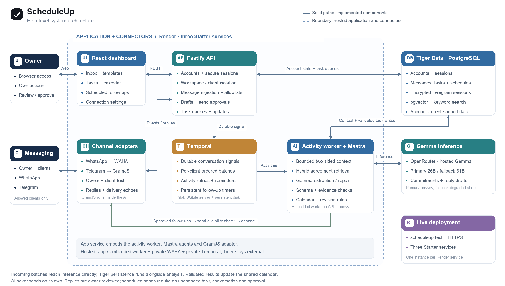

# System overview

[Editable SVG](scheduleup-architecture.svg) · [Mermaid source](system.mmd) · [Detailed architecture](ARCHITECTURE.md)

## Deployment boundary

The live product is https://scheduleup.tech. Render hosts three Singapore Starter services, each configured for one instance. The API serves the built React dashboard and embeds both the Temporal activity worker and GramJS Telegram adapter. These are logical components inside one app service, not separately deployed workers.

| Component | Responsibility |
|---|---|
| React dashboard | Conversations, task calendar, review requests, templates, scheduled follow-ups and connection settings |
| Fastify API | Account authentication, workspace isolation, validation, intake and owner-approved actions |
| WAHA private service | QR-linked personal WhatsApp sessions, signed webhooks and reviewed sends |
| GramJS inside API | Personal Telegram QR login, allowed private conversations, text ingestion and sends |
| Temporal private service | Durable per-client signals, analysis activities, reminders and approved-send timers |
| Mastra inside app | Gemma extraction, repair and editable draft generation |
| OpenRouter / Gemma | External hosted inference; primary 26B model and configured 31B fallback |
| Tiger Data | External PostgreSQL authoritative state, encrypted Telegram sessions and hybrid retrieval index |

WAHA has a 1 GB session disk. Temporal has a 1 GB SQLite history disk and uses its development server. Tiger and OpenRouter are outside Render's app/private-service boundary. The embedding model runs inside the app; Gemma does not.

## Main flows

Incoming allowed text → identity checks → pause existing follow-up approvals → durable Temporal signal → ordered batch → message persistence and context-aware inference → schema/evidence/calendar/revision validation → Tiger state → dashboard.

Reviewed outgoing text → account/client checks → outbox → channel adapter. Scheduled sends additionally require the approved time, unchanged task revision and conversation sequence, and acceptable lateness. AI has no send authority.

The configured fallback model failed the latest availability checks. See [validation](../testing/VALIDATION.md); the diagram shows configured components, not an assertion that every external endpoint is healthy.
