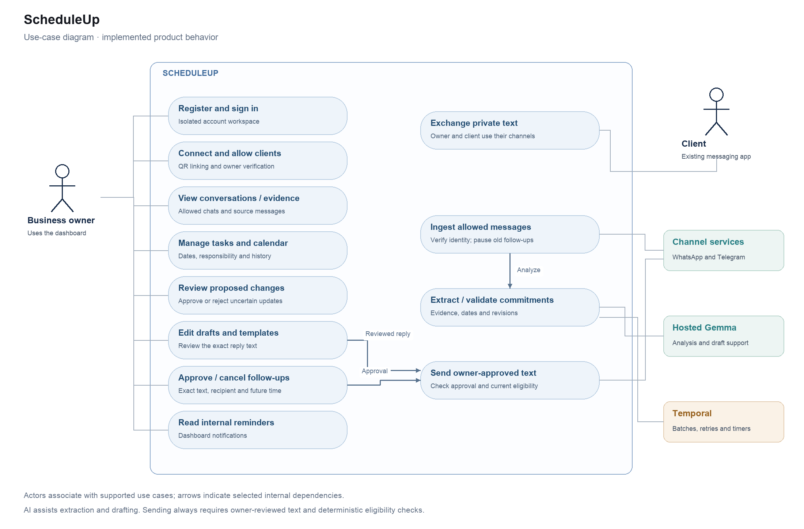

# Product use cases

[Editable SVG](scheduleup-use-cases.svg) · [Mermaid source](use-cases.mmd)

The owner uses the dashboard and approves outgoing messages. Clients participate through their existing messaging apps and need no ScheduleUp account. WhatsApp/Telegram supply allowed text and deliver reviewed messages. Hosted AI assists analysis and drafting; the owner and deterministic checks retain action authority.

| Actor | Implemented use cases |
|---|---|
| Business owner | Register/sign in; connect channels; manage allowed clients; view conversations/evidence; manage tasks/calendar; review changes; create/edit drafts/templates; send reviewed replies; approve/cancel follow-ups; read reminders |
| Client | Exchange private text with the owner; request work, agree dates and promise inputs through WhatsApp/Telegram |
| Channel services | Supply account-scoped messages and delivery signals; deliver owner-approved text |
| Hosted AI | Propose commitment changes and editable reply text |
| Workflow service | Batch durable messages; retry analysis; maintain reminders and approved-send timers |

An incoming message includes linked-owner/allowlist validation and pausing old follow-ups. Task updates include evidence/calendar/revision validation. A scheduled send includes exact approval and a fresh eligibility check. A reply draft can assist composing a message but never triggers sending by itself.

Media analysis, group chat, automated sales outreach, autonomous AI replies, cross-platform contact merging and unlimited historical import are outside the supported use cases.
